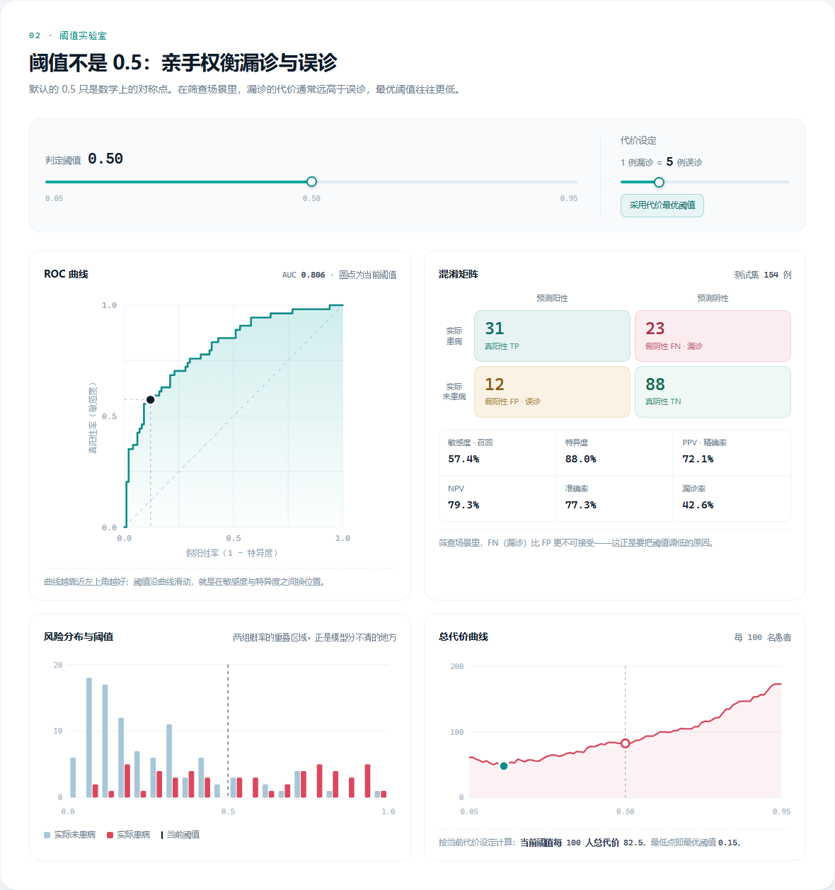

# 糖尿病风险 · 决策阈值实验室

> 医学人工智能导论课程项目 —— 把「模型输出的概率」和「临床决策的阈值」放在同一张桌子上。
>
> 仓库：<https://github.com/juwairenyixia/->


一个**纯静态**的交互式网页：输入 8 项常规指标，实时得到糖尿病风险概率；再拖动阈值，观察敏感度、特异度、混淆矩阵与临床代价如何互相拉扯。

没有后端、没有框架、没有网络请求。所有计算都发生在浏览器里。

---

## 为什么做「阈值」这个题

大多数课程 demo 停在「模型输出一个概率」。但在真实筛查场景里，0.5 并不是一个安全的默认值：漏掉一个患者（FN）的代价，通常远高于一次误报（FP）。

本项目用测试集 154 例的**真实预测评分**（而不是预设动画）实时重算全部指标，于是这件事可以被直接看见：

| 判定阈值 | 敏感度 | 特异度 | 漏诊 FN | 误诊 FP |
| --- | --- | --- | --- | --- |
| 0.50（默认） | 57.4% | 88.0% | 23 | 12 |
| 0.15（代价比 5:1 时的最优） | 94.4% | 41.0% | 3 | 59 |

同一个模型，只是把阈值从 0.50 挪到 0.15，漏诊就从 23 人降到 3 人——代价是误诊从 12 人涨到 59 人。**这个交换是否值得，是临床问题，不是数学问题。**

---

## 功能

- **实时风险预测**：8 项指标滑杆，概率仪表盘、风险分层、人群百分位同步更新
- **可解释性**：每项指标的 log-odds 贡献条形图，右侧同步给出「截距 + 贡献 = logit → 概率」的拆解
- **示例病例**：低风险 / 临界 / 高风险 / 随机，载入后可揭晓真实结局，直接对比模型判断
- **阈值实验室**：ROC 工作点、混淆矩阵、6 项指标随阈值实时联动
- **代价敏感分析**：漏诊 : 误诊 可在 1–20 之间调节，自动计算代价最优阈值
- **风险分布**：两组预测概率的直方图，直观看模型在哪些区间分不清
- **响应式**：桌面、平板、手机三档布局；支持键盘操作与 `prefers-reduced-motion`



---

## 快速开始

直接双击 `index.html` 即可（数据已内联为 JS，`file://` 下也能正常工作）。

或者起一个本地静态服务：

```bash
python -m http.server 8000
# 打开 http://localhost:8000
```

---

## 目录结构

```
.
├── index.html              # 页面结构
├── assets/
│   ├── css/style.css       # 设计系统与全部样式（约 1000 行）
│   └── js/
│       ├── data.js         # 由训练脚本生成：模型参数 + 154 条测试评分
│       └── app.js          # 交互逻辑与手写 SVG 图表
├── data/pima.csv           # 原始数据（768 × 9）
├── scripts/train.py        # 纯标准库实现的训练与导出
├── docs/                   # README 截图
├── README.md
└── LICENSE
```

---

## 模型与数据

| 项目 | 说明 |
| --- | --- |
| 数据 | Pima Indians Diabetes Database（NIDDK，1988；UCI 公开） |
| 人群 | 768 名 ≥21 岁皮马族女性，患病率 34.9% |
| 缺失处理 | Glucose、BloodPressure、SkinThickness、Insulin、BMI 的 0 值视为缺失，用训练集中位数插补 |
| 特征处理 | z-score 标准化（均值/标准差均来自训练集） |
| 模型 | L2 正则逻辑回归（λ = 1e-4），IRLS 求解 |
| 划分 | 分层 8 : 2，`seed = 42` → 训练 614 / 测试 154 |
| 测试集 AUC | 0.8065（页面显示 0.806） |
| Brier 分数 | 0.1644 |

阈值 0.5 时：敏感度 57.4%、特异度 88.0%、PPV 72.1%、NPV 79.3%、准确率 77.3%。

### 页面里的数字从哪来

`assets/js/data.js` 由 `scripts/train.py` 生成，包含：

- 标准化前的均值与标准差（让浏览器能用原始输入值直接推理）
- 逻辑回归的截距与 8 个系数
- 154 条测试集记录：`[预测概率, 真实标签]`

页面用这 154 条评分实时计算混淆矩阵、ROC、分布直方图和代价曲线。所以拖动阈值时看到的一切都是真实计算结果，换数据或换模型后重新生成 `data.js` 即可。

---

## 复现训练

```bash
python scripts/train.py
```

- 只需要 Python 3.8+，**不需要 numpy / pandas / scikit-learn**
- 会重新写出 `assets/js/data.js`
- 脚本内置固定随机种子，结果可复现

数据来源：[Pima Indians Diabetes Database](https://www.openml.org/d/37)（也可从 UCI / Kaggle 获取同名数据）。

---

## 部署到 GitHub Pages

仓库已初始化并完成首次提交。把远程地址换成你自己的即可：

```bash
git remote add origin https://github.com/<你的用户名>/<仓库名>.git
git push -u origin main
```

然后在 GitHub 仓库中：

1. **Settings → Pages**
2. **Build and deployment → Source** 选择 **Deploy from a branch**
3. 分支选 **main**，目录选 **/(root)**，保存
4. 一两分钟后访问 `https://juwairenyixia.github.io/-/`

> 仓库名目前是 `-`，所以 Pages 地址会带一个 `/-/`。如果觉得别扭，可以在 **Settings → General → Repository name** 改成 `diabetes-threshold-lab`，再把远程地址改成新地址，页面地址也会随之变成 `https://juwairenyixia.github.io/diabetes-threshold-lab/`。

---

## 可以继续做的方向

- 校准曲线（reliability diagram）：概率是否「说到做到」
- 决策曲线分析（DCA）：把「净收益」也画出来
- 亚组分析：按年龄、家族史分层看性能差异
- 换梯度提升 / 随机森林做模型对照
- 加入外部验证集，讨论域偏移

---

## 局限与免责声明

- 数据单一族群、仅女性、样本仅 768 例，且年代久远
- 未做外部验证与概率校准，不能用于临床
- 概率是群体统计结果，不等于个体诊断
- **本项目为教学演示，不构成任何医疗建议**

数据版权归原作者；代码以 MIT 许可开源。
