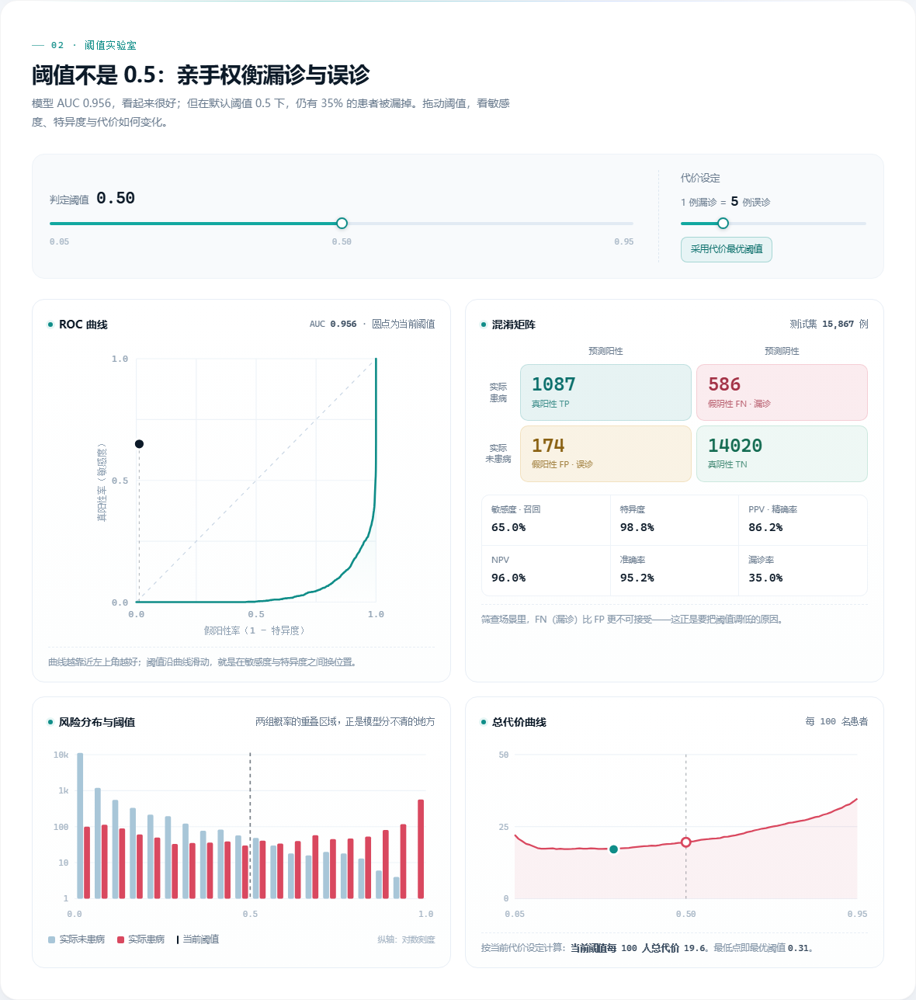

# 糖尿病风险 · 决策阈值实验室

> 医学人工智能导论课程项目 —— 把「模型输出的概率」和「临床决策的阈值」放在同一张桌子上。
>
> 仓库：<https://github.com/juwairenyixia/diabetes-threshold-lab>

## 🚀 在线访问

**<https://juwairenyixia.github.io/diabetes-threshold-lab/>**

| 页面 | 直达链接 |
| --- | --- |
| 首页（3D 致病因素图谱） | <https://juwairenyixia.github.io/diabetes-threshold-lab/> |
| 风险预测实验室 | <https://juwairenyixia.github.io/diabetes-threshold-lab/risk.html> |

无需安装、无需登录，打开即可使用。建议用 Chrome / Edge / Safari 等现代浏览器。


站点有两个页面：

| 页面 | 路径 | 作用 |
| --- | --- | --- |
| **首页** | `index.html` | 3D 球形树状图展示诱发糖尿病的四类因素，悬停看说明，点击按钮进入预测 |
| **风险预测** | `risk.html` | 患者评估、阈值实验室、模型卡 |

一个**纯静态**的交互式网页：选择性别、输入 8 项指标，实时得到糖尿病风险概率；再拖动阈值，观察敏感度、特异度、混淆矩阵与临床代价如何互相拉扯。

数据同时包含女性与男性，**性别本身参与建模**；结果里的百分位也按同性别测试人群计算。

没有后端、没有框架、没有网络请求。所有计算都发生在浏览器里。

---

## 首页：3D 球形树状图

- 中心是「糖尿病」，向外是 4 个类别分支、20 个因素节点
- 球面用斐波那契网格均匀布点，节点按深度排序、近大远小，形成立体球感
- 支持鼠标拖动旋转、松手后的惯性；悬停任一节点弹出说明
- 标签沿径向推到球外并做碰撞剔除与边界检查，避免相互压盖或溢出
- **零依赖**：用 Canvas 2D 手写透视投影与深度排序，没有引入 Three.js

因素按四类分组：

| 类别 | 因素 |
| --- | --- |
| 代谢指标 | 糖化血红蛋白、空腹血糖、BMI、腹型肥胖、胰岛素抵抗 |
| 生活方式 | 吸烟、缺乏运动、高糖高脂饮食、睡眠不足、长期压力、过量饮酒 |
| 人群与遗传 | 年龄增长、家族史、遗传易感基因、妊娠糖尿病史 |
| 合并疾病 | 高血压、冠心病、血脂异常、多囊卵巢综合征、代谢综合征 |

> 图谱用于科普展示，说明因素的**分类与方向性**，不代表模型中每个因素的量化权重——模型实际只用到性别、年龄、BMI、HbA1c、空腹血糖、高血压、冠心病、吸烟史 8 项。

---

## 风险预测：为什么做「阈值」这个题

模型 AUC 0.956，看起来已经很好。但在默认阈值 0.5 下，测试集里仍有 **35% 的患者被漏掉**：

| 判定阈值 | 敏感度 | 特异度 | 漏诊 FN | 误诊 FP |
| --- | --- | --- | --- | --- |
| 0.50（默认） | 65.0% | 98.8% | 586 | 174 |
| 0.31（代价比 5:1 时的最优） | 73.2% | 96.6% | 448 | 476 |
| 0.10（高敏感设置） | 87.3% | 87.3% | 213 | 1808 |

同一个模型，只是把阈值从 0.50 挪到 0.10，漏诊就从 586 人降到 213 人——代价是误诊从 174 人涨到 1,808 人。**这个交换是否值得，是临床问题，不是数学问题。**

---

## 风险预测页功能

- **性别选择**：女性 / 男性切换，性别作为模型输入参与计算，结果按同性别测试人群给出百分位
- **首屏概览**：右侧悬浮卡实时绘制代价曲线，直接标出「默认阈值 0.50 / 漏诊 586 例 / 代价最优 0.31」
- **概率标尺**：把当前患者、判定阈值、代价最优阈值放在同一根 0–1 轴上，一眼看出差距
- **混合输入**：4 个连续滑杆（年龄、BMI、糖化血红蛋白、空腹血糖）+ 2 个开关（高血压、冠心病）+ 1 个下拉（吸烟史）
- **实时反馈**：拖动滑杆时数值气泡跟随拇指移动，概率、仪表盘、百分位、贡献图同步更新
- **可解释性**：每项指标的 log-odds 贡献条形图，右侧同步给出「截距 + 贡献 = logit → 概率」的拆解
- **示例病例**：低风险 / 高风险两个示例，按当前性别自动匹配；载入后可揭晓真实结局
- **阈值实验室**：ROC 工作点、混淆矩阵、6 项指标随阈值实时联动
- **代价敏感分析**：漏诊 : 误诊 可在 1–20 之间调节，自动计算代价最优阈值
- **风险分布**：两组预测概率的直方图（对数纵轴），直观看模型在哪些区间分不清
- **响应式**：桌面、平板、手机三档布局；支持键盘操作与 `prefers-reduced-motion`



---

## 快速开始

直接双击 `index.html` 即可（数据已内联为 JS，`file://` 下也能正常工作）。首页的「开始糖尿病风险预测」按钮会跳转到 `risk.html`。

或者起一个本地静态服务：

```bash
python -m http.server 8000
# 打开 http://localhost:8000
```

---

## 目录结构

```
.
├── index.html                    # 首页：3D 球形树状图
├── risk.html                     # 风险预测：患者评估 / 阈值实验室 / 模型卡
├── assets/
│   ├── css/
│   │   ├── home.css              # 首页样式
│   │   └── style.css             # 预测页设计系统与全部样式
│   └── js/
│       ├── home.js               # 3D 球图渲染（Canvas 2D 手写投影）
│       ├── data.js               # 由训练脚本生成：模型参数 + 15,867 条测试评分
│       └── app.js                # 预测页交互逻辑与手写 SVG 图表
├── data/diabetes_prediction.csv  # 原始数据（100,000 × 9，约 3.8 MB）
├── scripts/train.py              # 纯标准库实现的清洗、训练与导出
├── docs/                         # README 截图
├── README.md
└── LICENSE
```

---

## 模型与数据

| 项目 | 说明 |
| --- | --- |
| 数据 | [Diabetes Prediction Dataset](https://www.kaggle.com/datasets/iammustafatz/diabetes-prediction-dataset)（Kaggle，10 万条 EHR 衍生记录） |
| 清洗 | 剔除性别 Other（18 条）、限制 18 岁以上、BMI 10–60、精确去重 3,323 条 → **79,334 例** |
| 人群 | 女性 47,892（患病率 9.1%） / 男性 31,442（患病率 12.7%）；总体 10.5% |
| 输入 | 性别、年龄、BMI、糖化血红蛋白（HbA1c）、空腹血糖、高血压、冠心病、吸烟史 |
| 预处理 | 连续变量 z-score 标准化（均值/标准差来自训练集）；吸烟史 one-hot，以「从不吸烟」为参照 |
| 模型 | L2 正则逻辑回归（λ = 1e-4），IRLS 求解 |
| 划分 | 分层 8 : 2，`seed = 42` → 训练 63,467 / 测试 15,867 |
| 测试集 AUC | 0.9557（页面显示 0.956） |
| Brier 分数 | 0.0388 |

阈值 0.5 时：敏感度 65.0%、特异度 98.8%、PPV 86.2%、NPV 96.0%、准确率 95.2%。

### 页面里的数字从哪来

`assets/js/data.js` 由 `scripts/train.py` 生成，包含：

- 连续特征的均值与标准差（让浏览器能用原始输入值直接推理）
- 逻辑回归的截距与各项系数（含性别、吸烟史哑变量）
- 15,867 条测试集记录：`[预测概率, 真实标签, 性别]`

页面用这些评分实时计算混淆矩阵、ROC、分布直方图和代价曲线。阈值交互是真实的，不是预演动画。

---

## 复现训练

```bash
python scripts/train.py
```

- 只需要 Python 3.8+，**不需要 numpy / pandas / scikit-learn**
- 会重新写出 `assets/js/data.js`
- 脚本内置固定随机种子，结果可复现

原始 CSV 保留在 `data/` 下，便于核对；如果只想保留网页，可以删掉它，页面不依赖该文件。

---

## 部署到 GitHub Pages

代码已推送到 <https://github.com/juwairenyixia/diabetes-threshold-lab>。

线上站点（仓库 `main` 分支根目录，`Deploy from a branch` 方式发布）：

- 首页：<https://juwairenyixia.github.io/diabetes-threshold-lab/>
- 预测页：<https://juwairenyixia.github.io/diabetes-threshold-lab/risk.html>

更新后一般 1–2 分钟生效；若浏览器显示旧版本，强制刷新（Ctrl/Cmd + Shift + R）即可。

如果需要在另一台机器上重新推送：

```bash
git remote add origin https://github.com/juwairenyixia/diabetes-threshold-lab.git
git push -u origin main
```

---

## 可以继续做的方向

- 校准曲线（reliability diagram）：概率是否「说到做到」
- 决策曲线分析（DCA）：把「净收益」也画出来
- 分性别报告性能：女性 / 男性各自的 ROC 与校准
- 换梯度提升 / 随机森林做模型对照
- 加入外部验证集，讨论域偏移

---

## 局限与免责声明

- 数据是 Kaggle 上公开的 EHR 衍生数据集，并非前瞻性临床队列，字段含义与采集方式有限
- **数据集不含怀孕次数等女性专属变量**，所以性别只能作为模型输入参与风险计算，表单字段不会随性别增减——这是数据层的限制，不是界面遗漏
- 性别只有女性 / 男性两类；Other 仅 18 条，已剔除
- 类别不平衡（患病率 10.5%），阈值 0.5 下漏诊率偏高
- 未做外部验证与概率校准，不能用于临床
- **本项目为教学演示，不构成任何医疗建议**

数据版权归原作者；代码以 MIT 许可开源。
